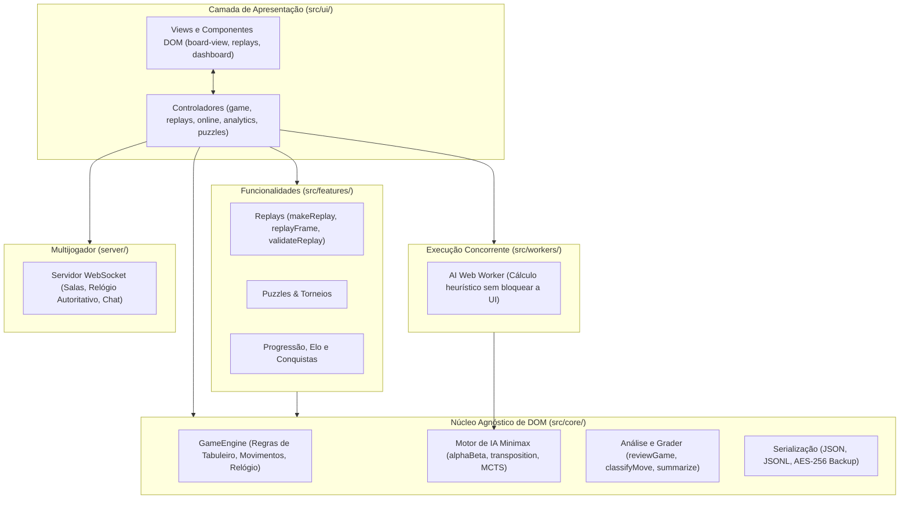
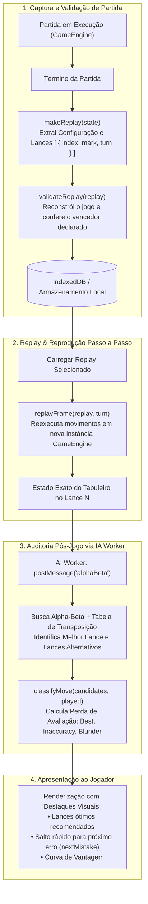
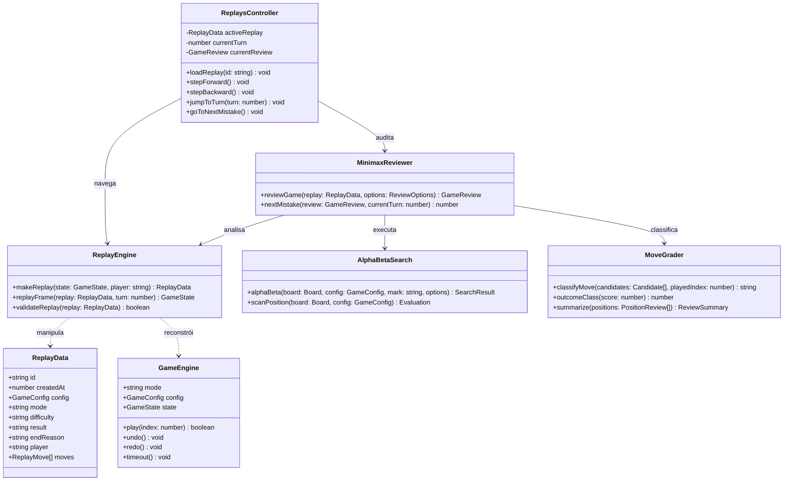
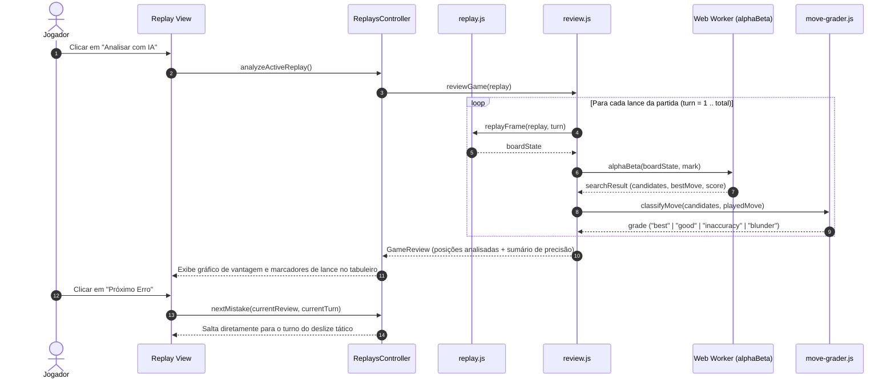
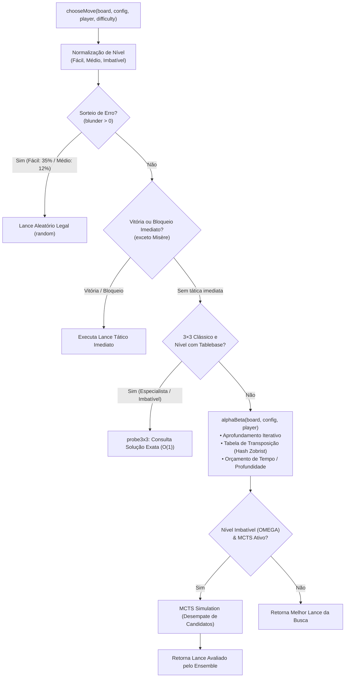

# Arquitetura do Sistema — OMEGA Tic-Tac-Toe

Este documento apresenta a arquitetura de software, o particionamento em camadas e a modelagem detalhada do módulo **Minimax Replay** do **Jogo da Velha (OMEGA Tic-Tac-Toe)**. Para uma consulta ainda mais aprofundada, veja também [docs/arquitetura/ARCHITECTURE.md](docs/arquitetura/ARCHITECTURE.md) e [docs/INDICE.md](docs/INDICE.md).

---

## 1. Visão Geral da Arquitetura e Camadas

O sistema foi concebido com estrita separação entre lógica de negócio (independente de DOM e executável em Node.js), interface reativa e serviços em background.

---

## 2. Módulo Minimax Replay & Auditoria de Lances

O módulo **Minimax Replay** atua na captura e conferência de partidas, na reconstrução instantânea de qualquer lance histórico e na avaliação heurística de decisões usando busca minimax com poda alpha-beta.

### 2.1 Fluxo de Execução do Replay (Flowchart)

### 2.2 Estrutura de Classes do Replay (ClassDiagram)

### 2.3 Sequência de Execução de Análise (SequenceDiagram)

### 2.4 Fluxo de Tomada de Decisão da IA Minimax (Flowchart)

---

## 3. Pilares Arquiteturais do Sistema

### 3.1 Motor Minimax com Poda Alpha-Beta e Níveis Parametrizados
- **Fácil (`easy` / `facil`)**: Profundidade 1, taxa de erro deliberado de 35% (`blunder: 0.35`). Permite vitórias acessíveis para iniciantes.
- **Médio (`normal` / `medio` / `medium`)**: Profundidade 2, erro reduzido (`blunder: 0.12`), busca tática equilibrada sem tablebase.
- **Difícil (`hard`)**: Profundidade 4, taxa mínima de erro (`blunder: 0.03`).
- **Especialista (`expert`)**: Profundidade 6, erro zero (`blunder: 0`), consulta direta à `tablebase3x3` no tabuleiro clássico.
- **Imbatível (`omega` / `imbativel` / `unbeatable`)**: Profundidade até 10, tempo estendido, `tablebase3x3` e desempate com MCTS (Monte Carlo Tree Search) em tabuleiros maiores.

### 3.2 Tabuleiros Parametrizáveis e Modo 4×4 Opcional
- O `GameEngine` opera sobre tabuleiros de dimensão $N \times N$ ($3 \le N \le 12$), com suporte nativo a seleção rápida para o **modo 4×4**.
- O parâmetro `winLength` é dinamicamente ajustável de 3 até $N$.
- A validação em `validator.js` e a detecção em `win.js` suportam tabuleiros quadrados (`classic`, `misere`, `gravity`, `fade`) e axiais (`hex`).

### 3.3 Histórico com Replay Passo a Passo (Time Travel)
- **Reconstrução Determinística**: Ao invés de armazenar snapshots de matrizes em cada lance, o modelo grava apenas a lista linear de movimentos `{ index, mark, turn }`.
- **Navegação Temporal**: O método `replayFrame(replay, turn)` reconstrói em tempo linear qualquer ponto do tempo.
- **Controle Acessível**: Suporte a atalhos de teclado (Setas Esquerda/Direita, Home, End, Espaço) e auditoria pós-jogo (`reviewGame`) com salto automático para o próximo erro (`nextMistake`).

### 3.4 Estatísticas, Elo e Conquistas
- **Estatísticas Agregadas**: Registro de histórico, taxa de vitória, média de lances, sequências atuais e recordes.
- **Modelagem de Habilidade**: Implementação dupla de pontuação — Elo clássico e sistema probabilístico Glicko-2 (`rating`, `deviation`, `volatility`).
- **18 Conquistas Gamificadas**: Validadas puramente em `src/features/achievements.js` a partir de eventos de jogo (`first-win`, `streak-3`, `streak-7`, `streak-10`, `perfect`, `giant`, `omega`, `speed`, `variant-master`, etc.).

### 3.5 PWA (Progressive Web App) e Modo Offline
- **Service Worker Determinístico**: Injeção automática de manifest de precache durante o build Vite com hash SHA-256 de cada recurso estático gerado.
- **Funcionamento Offline**: Cache-first para assets locais e compatibilidade standalone com web app manifest.

### 3.6 Acessibilidade (W3C ARIA Grid e Teclado)
- **Estrutura Semântica**: `role="grid"` no container, `role="row"` nas linhas e `role="gridcell"` em cada célula com botões interativos.
- **Roving Tabindex**: Apenas uma célula do tabuleiro retém `tabindex="0"`, mantendo a navegação natural via Tab.
- **Navegação Completa por Teclado**:
  - `Setas Direcionais`: Navegação bidimensional entre células vizinhas.
  - `Home` / `End`: Salto para o início ou fim da linha atual.
  - `Ctrl + Home` / `Ctrl + End`: Salto para o primeiro (0, 0) ou último elemento do tabuleiro.
  - `PageUp` / `PageDown`: Salto para o topo ou base da coluna atual.
  - `Enter` / `Espaço`: Execução do lance.

---

## 4. Diretrizes de Engenharia e Princípios

- **Sem Frameworks no Core:** Todas as regras e algoritmos de busca residem em ECMAScript puro e não tocam propriedades do navegador (`window`, `document`, `navigator`), permitindo testes automatizados de alta performance com `node --test`.
- **Determinismo Absoluto:** Ao salvar uma partida, apenas as ações sequenciais são armazenadas. O estado do tabuleiro é sempre recalculado dinamicamente através do `GameEngine`, prevenindo inconsistências.
- **Não-bloqueio de Interface:** As buscas minimax operam de forma assíncrona dentro de Web Workers dedicados (`ai.worker.js`), garantindo taxa contínua de 60fps na renderização visual.
