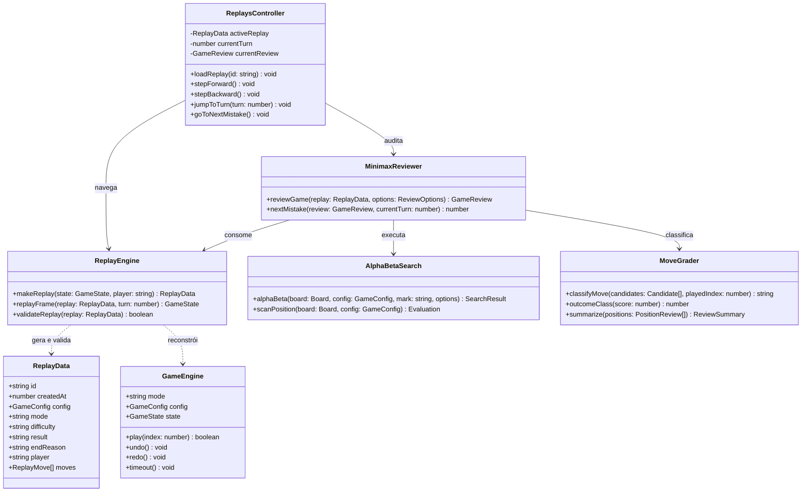
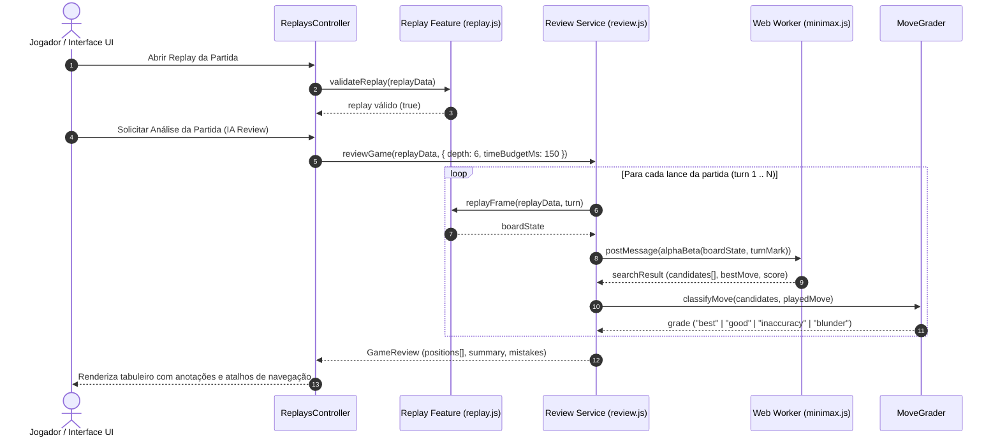

# OMEGA Tic-Tac-Toe

Jogo da velha generalizado que roda inteiro no navegador: tabuleiros de 3×3 a 12×12, três
variantes de regra, IA em cinco níveis, puzzles, torneios, replays e uso offline (PWA).
É JavaScript puro (módulos ES, sem framework), empacotado com Vite. Há também um servidor
WebSocket opcional para partidas online.

O projeto nasceu de um jogo da velha de três arquivos (preservado em `legacy/`) e foi crescendo
como exercício de engenharia: regras separadas da interface, busca em árvore, validação de dados
não confiáveis, testes.

## Funcionalidades

**Jogo**

- Tabuleiros de **3×3 a 12×12**, com **modo 4×4 opcional** de seleção rápida e linha de vitória configurável (de 3 até o tamanho do tabuleiro).
- Variantes: **Clássica**, **Misère** (quem completa a linha perde), **Gravity** (a peça cai até
  a casa livre mais baixa da coluna, como no Lig-4), **Hexagonal** (tabuleiro de hexágonos) e **Infinito/Fade**.
- **Contra o relógio**: tempo por lance e/ou por partida; quem estoura o tempo perde. O saldo de
  cada lado aparece ao lado do tabuleiro. Nas salas online o relógio é escolhido por quem cria a
  sala e controlado pelo servidor.
- Modos: contra a IA, dois jogadores no mesmo aparelho, IA × IA e online (salas com
  espectadores e chat moderado por quem criou a sala).
- **Série local** melhor de 3, 5 ou 7 entre duas pessoas: placar agregado, alternância de X
  em cada partida concluída, empate sem ponto, configuração/relógio consistentes e retomada após recarga.
- Desfazer/refazer, dica, partida salva automaticamente e retomada ao reabrir.

**IA Minimax com Alpha-Beta** (detalhes em [docs/ia/AI.md](docs/ia/AI.md))

- Níveis calibrados de força: **Fácil** (com erro deliberado de 35%), **Médio / Normal** (busca balanceada), **Difícil**, **Especialista** e **Imbatível / OMEGA** (solução exata em 3×3 clássico e busca profunda com MCTS).
- Poda Alpha-Beta com aprofundamento iterativo, tabela de transposição e tática imediata nas folhas.
- No 3×3 clássico, Especialista e Imbatível usam a solução exata (nunca perdem).
- O nível Imbatível desempata os melhores lances do alpha-beta com simulações MCTS.
- A busca roda inteiramente em um Web Worker: a interface não trava e mantém taxa de 60fps.

**Estudo e competição**

- Puzzles "vença em um lance" na variante clássica (quatro tamanhos) e na hexagonal (três), e um
  desafio diário igual para todos (derivado da data), com sequência e recorde local de dias resolvidos.
- Torneios de pontos corridos contra três níveis da IA, com classificação e campeão.
- **Histórico com Replay Passo a Passo (Time Travel)**: reconstrução instantânea e determinística de qualquer momento da partida (`replayFrame`), com reprodução automática ou manual via botões e atalhos de teclado (Setas, Home, End, Espaço).
- **Análise pós-jogo**: em cada posição, o lance jogado, a nota dele e os lances alternativos da
  busca, destacados no tabuleiro, com atalho para o próximo erro (`nextMistake`).
- **Ranking local** com um quadro por tamanho de tabuleiro e variante (Elo do quadro, V-E-D,
  melhor sequência e melhores vitórias).
- Arena IA × IA e laboratório de motores, com resultados e tempos medidos (nada é número fixo).
- Perfil local com Elo, Glicko-2, XP, sequência de vitórias, histórico e 18 conquistas.

**Plataforma, Acessibilidade e PWA**

- **PWA (Progressive Web App)**: Service Worker com cache offline de assets para jogar sem rede.
- Interface em português, inglês e espanhol; tema claro e escuro; opção de reduzir animações.
- **Controles por teclado acessíveis**: Implementação estrita da especificação W3C ARIA Grid (`role="grid"`, `row`, `gridcell`, `roving tabindex`). Navegação completa por setas direcionais, `Home`, `End`, `PageUp`, `PageDown`, `Ctrl+Home`, `Ctrl+End`, além de `Enter` e `Espaço` para jogar.
- Dados só no navegador (IndexedDB com espelho em localStorage). Backup em JSON, com opção de
  cifrar por senha (AES-256-GCM), e link de compartilhamento de partida.

## ⚡ Quick Start (Início Rápido em 3 Passos)

Requisitos: Node.js 22.13 ou mais novo.

1. **Clonar e Acessar o Repositório:**
   ```bash
   git clone https://github.com/seu-usuario/Jogo-da-velha.git && cd Jogo-da-velha
   ```

2. **Instalar Dependências:**
   ```bash
   npm ci
   ```

3. **Iniciar Servidor Dev e Jogar:**
   ```bash
   npm run dev
   ```
   Abra no seu navegador: `http://127.0.0.1:4173`

Build de produção (é nele que o service worker/offline funciona):

```bash
npm run build     # gera dist/
npm run preview   # serve dist/ em http://127.0.0.1:4173
```

### Partidas online (opcional)

```bash
npm run server    # servidor de salas em ws://localhost:8787
```

No app, escolha o modo **Online**, crie uma sala e passe o código de 6 caracteres para o outro
jogador. O servidor só aceita conexões das origens listadas em `OMEGA_CORS_ORIGIN` (por padrão,
`http://localhost:4173` e `http://127.0.0.1:4173`). Variáveis disponíveis: veja
[.env.example](.env.example) e [docs/multiplayer-infra/OPERATIONS.md](docs/multiplayer-infra/OPERATIONS.md).

## Como testar

```bash
npm test               # testes unitários e de integração (node --test)
npm run lint           # ESLint
npm run format:check   # Prettier
npm run check          # lint + formato + testes + build + verificação do build
npm run e2e            # Playwright contra o build de produção
```

O `npm run e2e` precisa de um navegador. Para usar o Chromium do Playwright rode antes
`npx playwright install chromium`; para usar um navegador já instalado, defina `PW_CHANNEL`
(`msedge` ou `chrome`).

Outros comandos: `npm run benchmark` (arena de força entre os níveis, pela linha de comando),
`npm run smoke`, `npm run audit`, `npm run ui-audit`, `npm run doctor`, `npm run sbom`.

## 🏛️ Arquitetura do Módulo Minimax Replay & Análise Pós-Jogo

O módulo **Minimax Replay** (`src/features/replay.js`, `src/core/analysis/review.js` e `src/core/ai/minimax.js`) combina serialização de partidas, reconstrução determinística de estados e auditoria de lances por busca heurística com poda alpha-beta e tabela de transposição.

### 1. Fluxo de Execução do Minimax Replay (Flowchart)

```mermaid
flowchart TD
    subgraph Capture["1. Gravação & Validação da Partida"]
        LiveGame["GameEngine (Partida em Andamento)"] --> MatchEnd["Fim de Jogo (Vitória / Empate / Timeout)"]
        MatchEnd --> MakeReplay["makeReplay(state)<br/>Configuração + Lista Cronológica de Lances"]
        MakeReplay --> ValidateReplay["validateReplay(replay)<br/>Conferência estrita das regras e resultado"]
        ValidateReplay --> ReplayDB[("IndexedDB / JSONL Storage<br/>Histórico de Partidas")]
    end

    subgraph Playback["2. Reconstrução Determinística de Quadros"]
        ReplayDB --> SelectReplay["Seleção do Replay"]
        SelectReplay --> ReplayFrame["replayFrame(replay, turn)<br/>Reexecuta lances via GameEngine isolado"]
        ReplayFrame --> BoardState["Estado do Tabuleiro no Turno t"]
    end

    subgraph Analysis["3. Auditoria com Minimax & Alpha-Beta"]
        BoardState --> WorkerDispatch["AI Worker Client (Thread Secundária)"]
        WorkerDispatch --> AlphaBetaSearch["alphaBeta(board, config, mark)<br/>• Poda Alpha-Beta<br/>• Tabela de Transposição<br/>• Aprofundamento Iterativo"]
        AlphaBetaSearch --> PositionReading["analyzePosition() + Heurística Tática"]
        PositionReading --> MoveGrading["classifyMove(candidates, played)<br/>best | excellent | inaccuracy | blunder"]
    end

    subgraph UI["4. Visualização Interativa"]
        MoveGrading --> ReviewSummary["Resumo Estatístico & Próximo Erro (nextMistake)"]
        ReviewSummary --> ReplayControls["Controles UI: Step, Play/Pause, Gráfico de Vantagem"]
    end
```



### 2. Diagrama de Classes do Módulo (ClassDiagram)



### 3. Sequência de Auditoria e Reprodução (SequenceDiagram)



## Estrutura

```text
index.html           página única
public/              manifesto, ícone e service worker (preenchido no build)
src/
  core/              regras e IA, sem DOM
    engine/          tabuleiro, motor da partida, vitória, validação de snapshots
    ai/              alpha-beta, MCTS, avaliação, solução exata do 3×3, escolha por nível
    analysis/        leitura da posição, classificação de lances, estatística
    serialization/   link de partida, backup, backup cifrado, JSONL
  features/          puzzles, torneios, replays, conquistas, registro de partidas, arena
  services/          i18n, Elo, Glicko-2, rede, som, cliente do Web Worker
  state/             perfil, armazenamento e validação do estado salvo
  ui/                controladores (um por área da tela), views e estilos
  workers/           Web Worker da IA
  index.js           API do motor para uso fora do app
server/              servidor WebSocket de salas
tests/               testes (node --test) e tests/e2e (Playwright)
scripts/             utilitários de linha de comando
docs/                documentação técnica (comece por docs/INDICE.md)
legacy/              o projeto original de três arquivos
```

Regra de dependência: `core` não importa nada das outras pastas; a interface nunca altera o
estado do jogo diretamente, só por `GameEngine`.

## Usando o motor em outro projeto

`src/index.js` não depende de DOM e funciona em Node:

```js
import { GameEngine, chooseMove } from './src/index.js';

const game = new GameEngine({ mode: 'local', config: { size: 5, winLength: 4 } });
game.play(12);
const { board, config, current } = game.state;
const verdict = chooseMove({ board, config, player: current, difficulty: 'hard' });
game.play(verdict.move);
```

Mais em [docs/arquitetura/LIBRARY_API.md](docs/arquitetura/LIBRARY_API.md).

## Limitações conhecidas

- **IA em tabuleiros grandes**: fora do 3×3 a busca é limitada por tempo e usa uma avaliação
  heurística. Em 8×8 ou maior ela é um adversário razoável, não forte. As medições estão em
  [docs/ia/AI_BENCHMARKS.md](docs/ia/AI_BENCHMARKS.md); em algumas configurações a diferença
  entre Especialista e OMEGA não é estatisticamente clara.
- **Online**: o servidor guarda as salas em memória (reiniciar apaga tudo), roda em um único
  processo e não tem contas de usuário; o código da sala funciona como convite. Partidas online
  não alteram o rating.
- **Rating**: Elo e Glicko-2 são calculados contra ratings nominais fixos atribuídos a cada nível
  da IA; servem para acompanhar a própria evolução, não para comparar com outras pessoas.
- **Relógio**: não existe no IA × IA. Contra a IA e entre 2 jogadores no mesmo aparelho o tempo
  é medido no navegador; em aba em segundo plano o navegador pode atrasar a verificação, mas a
  derrota é aplicada assim que a aba volta (ou no próximo lance). Online o servidor confere o
  relógio a cada 200 ms: essa é a precisão da derrota por tempo, somada à latência da rede.
- **Chat online**: fica só na memória do servidor (as últimas 50 mensagens por sala). A moderação
  é de quem criou a sala (silenciar e expulsar espectadores); não há denúncia nem moderação
  global. Expulsão bloqueia o endereço IP naquela sala, então quem troca de rede consegue voltar.
- **Hexagonal**: a IA usa a mesma avaliação por janelas das outras variantes.
- **Torneios**: só pontos corridos (não há mata-mata), sempre com você e três níveis da IA.
- **Puzzles**: apenas "vença em um lance", nas variantes clássica e hexagonal.
- **Ícone da PWA**: há só um ícone SVG. Navegadores que exigem PNG de 192/512 px podem não
  oferecer a instalação.
- **Docker**: o `Dockerfile` e o `docker-compose.yml` não foram executados no ambiente em que
  esta versão foi preparada (sem Docker instalado).
- **Dados**: tudo fica no navegador; limpar os dados do site apaga o perfil. Use o backup.

## Licença

MIT. Veja [LICENSE](LICENSE).
